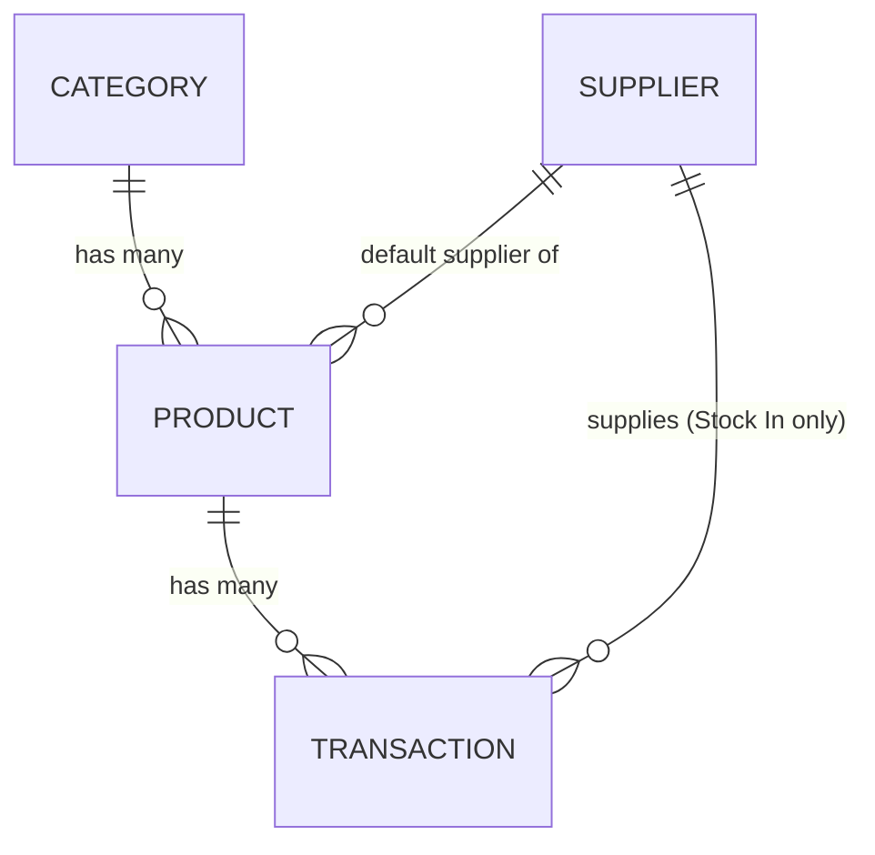

# Data Model — Inventory Management System

All data is stored in the browser's **localStorage** as JSON. There is no backend or database.

## 1. Storage Keys

| Data | localStorage key |
|---|---|
| Products | `inventory_products` |
| Categories | `inventory_categories` |
| Suppliers | `inventory_suppliers` |
| Stock Transactions (includes Opening, Stock In, Stock Out, Adjustments) | `inventory_transactions` |
| Application Settings | `inventory_settings` |

Stock Adjustments are **not** a separate list. They are stored inside the transactions list.

## 2. Category

| Field | Type | Notes |
|---|---|---|
| id | string | Internal unique id |
| code | string | Category Code, required, unique |
| name | string | Category Name, required, unique (case-insensitive) |
| description | string | Optional |
| status | "Active" / "Inactive" | |

Rule: a category used by an active product cannot be deactivated.

## 3. Supplier

| Field | Type | Notes |
|---|---|---|
| id | string | Internal unique id |
| code | string | Supplier Code, required, unique |
| name | string | Supplier Name, required |
| contactPerson | string | |
| email | string | Must be valid when entered |
| phone | string | |
| status | "Active" / "Inactive" | |

Rule: an inactive supplier cannot be selected for a new product or a new stock receipt.

## 4. Product

| Field | Type | Notes |
|---|---|---|
| id | string | Internal unique id |
| code | string | Product Code, required, unique, max 20 characters, not editable after creation |
| name | string | Required, 3–100 characters |
| categoryId | string | Required, points to a Category |
| supplierId | string | Required, default supplier, points to a Supplier |
| description | string | Optional, max 500 characters |
| unit | string | Unit of Measure, required (Pieces, Boxes, etc.) |
| unitCost | number | Required, greater than zero |
| openingStock | number | Nonnegative integer, set only at creation |
| reorderLevel | number | Required, nonnegative integer |
| status | "Active" / "Inactive" | |

**Calculated values (not saved in the product):**

| Value | Formula |
|---|---|
| Available Stock | Opening Stock + Stock In − Stock Out + Net Adjustments (calculated from transactions) |
| Stock Status | 0 → Out of Stock; ≤ Reorder Level → Low Stock; otherwise In Stock |
| Inventory Value | Available Stock × unitCost |
| Shortfall | max(0, reorderLevel − Available Stock) |

## 5. Transaction

Every stock movement is one transaction. Transactions are **immutable** (cannot be edited or deleted).

| Field | Type | Notes |
|---|---|---|
| id | string | Transaction ID / Reference, auto-generated, unique (for example `TXN-0001`) |
| productId | string | Points to a Product |
| type | string | "Opening", "Stock In", "Stock Out" or "Adjustment" |
| quantityChange | number | Positive for increase, negative for decrease |
| balanceAfter | number | Stock after this transaction |
| date | string | Date and time, auto-generated (ISO format) |
| referenceNumber | string | Optional, source/reference number (Stock In) |
| remarks | string | Optional details |

Extra fields used only by some types:

| Type | Extra fields |
|---|---|
| Stock In | supplierId (required, active supplier), unitCost (positive number), referenceNumber |
| Stock Out | issuedTo, department, purpose (all required) |
| Adjustment | reason (required), systemStock and actualStock used to calculate the difference |

## 6. Application Settings (`inventory_settings`)

Holds small app-level values. Currently it holds a flag showing that sample data has already been loaded.

## 7. Relationships

In simple words:

- One **category** can have many **products**. Each product has exactly one category.
- One **supplier** can be the default supplier of many products. Each product has one default supplier.
- One **product** has many **transactions**. Each transaction belongs to one product.
- A **Stock In** transaction also points to a supplier.

Products, categories and suppliers refer to each other using ids (`categoryId`, `supplierId`, `productId`), not by copying names.

## 8. Example: How Stock Is Calculated

Product starts with 20 units:

| Transaction | quantityChange | balanceAfter |
|---|---|---|
| Opening | +20 | 20 |
| Stock In | +15 | 35 |
| Stock Out | −8 | 27 |
| Adjustment | −2 | 25 |

Available Stock = 20 + 15 − 8 − 2 = **25**.