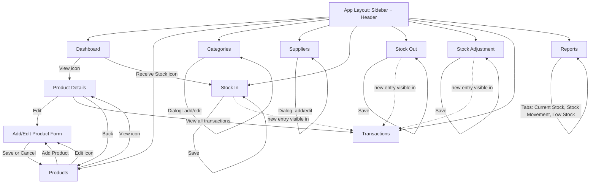

# Navigation Flow — Inventory Management System

## 1. Common Layout

Every page uses the same layout:

- **Sidebar** (left): Dashboard, Products, Categories, Suppliers, Stock In, Stock Out, Stock Adjustment, Transactions, Reports
- **Header** (top): current page title and today's date
- **Content area**: the selected screen

The active sidebar item is highlighted. Navigation uses React Router, so the page does not reload.

## 2. Sidebar Menu → Screens

| Sidebar item | Route | Screen |
|---|---|---|
| Dashboard | `/` | INV-01 Dashboard |
| Products | `/products` | INV-02 Product List |
| Categories | `/categories` | INV-05 Category Management |
| Suppliers | `/suppliers` | INV-06 Supplier Management |
| Stock In | `/stock-in` | INV-07 Stock In |
| Stock Out | `/stock-out` | INV-08 Stock Out |
| Stock Adjustment | `/stock-adjustment` | INV-09 Stock Adjustment |
| Transactions | `/transactions` | INV-10 Transaction History |
| Reports | `/reports` | INV-11 Low Stock Report and INV-12 Inventory Reports (as tabs) |

Other screens reached from inside these pages:

| Screen | Route | Reached from |
|---|---|---|
| INV-03 Add Product | `/products/new` | Products → Add Product button |
| INV-03 Edit Product | `/products/:id/edit` | Products → Edit (pencil) icon, or Product Details → Edit |
| INV-04 Product Details | `/products/:id` | Products → View (eye) icon, or Dashboard replenishment list |
| Transactions for one product | `/transactions?productId=...` | Product Details → View all transactions |
| Not Found message | any other address, and a missing product id | Wrong address or a product that does not exist |

## 3. Flow Diagram

## 4. How Users Move Between Screens

**Dashboard**
- Shows KPI cards, the stock-by-category chart and the products needing replenishment.
- From the replenishment list, the user can open a product's details (eye icon) or go to Stock In (receive icon).
- Dashboard values update after any stock transaction.

**Products**
- Search, filter, sort and paginate the list.
- *Add Product* opens the Add/Edit form. The pencil icon opens the same form with saved values. The eye icon opens Product Details.
- After saving or cancelling the form, the user returns to the Product List.
- The block icon (Deactivate) asks for confirmation in a dialog, then the product stays in the list as Inactive. The check icon (Activate) makes it active again.

**Product Details**
- Shows all product data, available stock, inventory value, stock status and the latest 10 transactions.
- *View all transactions* opens Transaction History filtered to that product.
- If the product id does not exist, a friendly "product not found" message is shown with a link back to Products.

**Categories and Suppliers**
- List page with Add and Edit in a dialog.
- Deactivate asks for confirmation. A category used by an active product cannot be deactivated (an error message is shown).

**Stock In / Stock Out / Stock Adjustment**
- Each is a form page. The user selects a product (only active products), fills the fields and saves.
- After a successful save, a Snackbar confirms it and the form is cleared. The new transaction is visible in Transactions.
- If validation fails (for example, issuing more than available), an error is shown and nothing is saved.

**Transactions**
- Read-only list of all movements, with filters by product, type and date range, plus sorting and pagination.
- No edit or delete actions exist for transactions.

**Reports**
- Three tabs: Current Stock, Stock Movement, Low Stock.
- Each report has filters and an *Export CSV* button that exports exactly the rows shown after filtering.

## 5. Typical User Journeys

1. **Receive new stock:** Sidebar → Stock In → choose product and supplier → enter quantity and unit cost → Save → success message → Transactions shows the new entry → Dashboard totals are updated.
2. **Issue stock:** Sidebar → Stock Out → choose product → enter quantity, issued to, department, purpose → Save (blocked if quantity is more than available).
3. **Fix a stock difference:** Sidebar → Stock Adjustment → choose product → enter actual physical stock and reason → Save → difference is recorded in history.
4. **Add a product:** Sidebar → Products → Add Product → fill form → Save → product appears in the list.
5. **Find what to re-order:** Sidebar → Dashboard (replenishment list) or Reports → Low Stock → Export CSV.